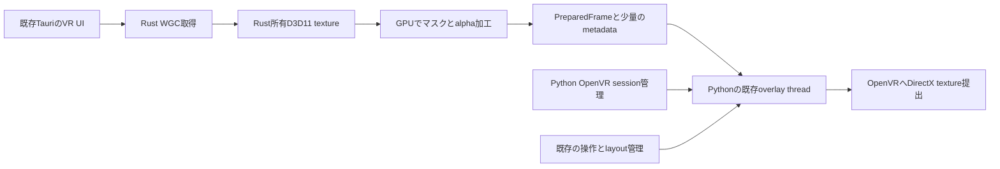
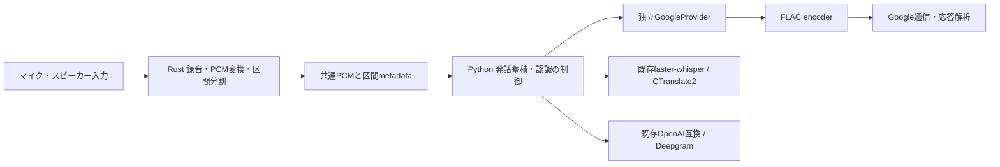

# VRCT Rust 部分移行の先行設計

7/8後の配布統合確認: 最新DLLとPython変更を含むCPU/CUDAの全sidecarを隔離環境で再構築し、両buildと生成exeの限定runtime検証が成功した。音声9モジュールの凍結code object、新DLL・MIT通知・モデルのhash、旧SR非同梱、CUDA数学DLL11本を確認。これで7/8時点の「全sidecar再ビルド未実施」は解消した。実controller起動、デバイス録音、外部認識、GPU推論は引き続き別の検証条件である。

サイクル7/8の更新: MIT条件で利用できる`dasp_sample =0.11.0`を追加し、VAD用の幅変換とモノラル化をRustの1 APIへ統合した。ライセンス本文は公開元commitを固定してwheelへ同梱。既存ratecvの数値・状態と対象外形式の経路は維持する。続いて同じ発話の16kHz/16bit raw/WAV再変換を省き、Whisperの余分な配列コピーを削除した。通常録音チャンクの削減は数µs、複数候補の認識前処理は48kHz/15秒/3候補でWAV25.75→8.07ms、Whisper25.15→8.63ms。単候補の改善は主張しない。両サイクルの独立レビュー、CPU/CUDA回帰、最新DLL/変更モジュールを同梱した限定exe検証は完了。実機・外部ASR・GPU推論や最新DLLでの全sidecar再ビルドとは区別する。測定・検証・残条件は`progress.md`の7/8と`docs/benchmarks`を参照。

サイクル6の更新: ユーザーの依頼により`custom_speech_recognition`の実行時・テスト・計測ツール依存を除去し、CPU/CUDAの配布設定からも除外した。録音listenerと通常FLACは既存Rust拡張を必須とする。flacencの上限を超える96kHz超のFLACのみ、既存PyAVで元rateを維持する。Google通信とPyAudioWPatchは維持し、由来コードのBSD通知も残す。独立設計・実装レビュー、SR import禁止下のCPU/CUDA回帰、全sidecar buildと限定frozen smoke・旧SR非同梱確認は完了。実機録音・外部ASR・全アプリ起動とは区別する。詳細は`progress.md`のサイクル6を参照。

実装状況（2026-10-08更新）: 最初のdevelop `307dd796` を基準に、Google独立・共通PCM・Rust FLAC/VAD downmix・エネルギー区間検出・自前listener/source、非VAD speakerのPCM16多チャンネル変換まで実装。続く画像経路の比較では、4AでOCRのRGB/BGR往復を除去し、4BでOverlay起動演出の透過処理を既存OpenCVのnative演算へ変更した。通常frameのcrop/alpha適用をまとめたRust試作は、この境界で安定した改善を確認できず採用していない。5では最新develop `e1c24d1b`を既存変更を保全して取り込み、OCRの中間canvasを省いてfloat32 NCHWを直接生成する処理を追加。再学習モデルでval80＋holdout49画像の旧新tensor・推論出力・切出し画素一致を確認した。現在の検証結果と残作業は [progress.md](C:/Users/misyaguzi/.codex/worktrees/4508/VRCT/progress.md) と [native実装のREADME](C:/Users/misyaguzi/.codex/worktrees/4508/VRCT/native/vrct-audio/README.md) を参照。以下は先行設計時の提案を残したもので、GPU直接提出や全面Rust移行を実装済みとするものではない。

現在の判断: PyAudioWPatchは固定版C実装と実測から当面維持する。音声のPythonループはRust化の効果を確認できた一方、画素演算は既存OpenCVでコピーを減らす方法が今回の試作より速かった。次の大きな移行は、実機のcapture待ち・GL同期・OpenVR提出を分けて測定し、GPU直接提出による改善と資源寿命を確認できてから進める。Whisper/ONNXのnative推論をPython制御ごと置き換えること自体を高速化とは扱わない。

2026年10月7日。OCR再学習と起動高速化のdevelop統合後に、性能比較と実装を始められる状態を目的とする。[調査結果](C:/Users/misyaguzi/.codex/worktrees/4508/VRCT/docs/rust_backend_investigation_2026-10-07.md)を設計へ具体化したもの。以下のAPI名・追加ファイル名は提案であり、まだ実装していない。

**最初の比較対象はVR UIの画像経路とする。** PythonにUI操作、OpenVRセッション管理、設定、音声認識、翻訳を残し、WGC取得と画像加工をRustのPython拡張へ切り出す。画像取得だけを置き換えず、OpenVRへのD3D11テクスチャ提出まで含めてCPU往復の削減を評価する。効果と互換性の確認後に、本番の既定経路へ採用する。

音声については、ユーザーの方針に合わせ、**Google認識を独立したproviderへ移し、`custom_speech_recognition` が担う録音・音声処理をRustへ置き換える**設計を追加した。これはWhisper推論全体の移植とは分け、画像経路と独立した変更単位で進める。

この準備段階の成果は、切り出し境界、所有権、比較条件、実装順序、採用条件の設計。試作DLL、性能測定、本番切り替えは未実施。アプリコードや他の作業中ブランチは変更していない。

## 基準コードと進行中変更の接点

| 項目 | 観測した状態 | 設計への反映 |
|---|---|---|
| この調査worktree | `39b490bfd0ceaf398ae8e5b652c81bc4191c412d` | 元の調査とコード参照の基準 |
| ローカルdevelop | `307dd79615f5529f03a411961b215b3863feecbd` | 起動高速化の一部である `perf/startup-engine-checks` のmergeを確認。fetchはしていない |
| 上記2コミットの差分 | 13ファイル。エンジン確認の並列化、翻訳モデル一覧キャッシュ、関連テスト等 | overlay・音声処理・OCR本体は同一。起動速度の基準値はmerge後の版で採り直す |
| 追加OCR再学習 | 進行中の作業場所・最終成果物は未確認 | 重みだけの差と決めつけず、モデル契約も再照合する |

起動エンジン確認の変更は、クライアント準備をworker内へ移し、エンジン数に応じて並列確認するもの。設定保存は結果反映側で行う。画像用Rust拡張はVR UI有効化時、音声用Rust拡張は該当する音声機能の開始時にロード・初期化し、エンジン接続確認や起動時の全体importへ追加しない。

OCRは以前の再学習でも重みとconfidence閾値が同時に変わった。再学習後のモデルhash、入力dtype・shape・色順、出力decode、score式、閾値、NMS、paddingを記録してから比較する。現行の1280や0.7を公開ABIの固定値にしない。

## 最初に切り出す範囲



Rustが画像とD3D11リソースを所有し、Pythonが既存のOpenVR bindingで `setOverlayTexture` を呼ぶ。Rust側ではOpenVRを初期化・終了しない。この分担なら、OCRとClipboardも参加する [openvr_session.py](C:/Users/misyaguzi/.codex/worktrees/4508/VRCT/src-python/models/openvr_session.py:29) を最初の移行で変更する必要がない。

| Pythonに残す責務 | Rustへ移す責務 |
|---|---|
| OpenVRのacquire/release、overlay handle生成・破棄 | WGC capture sessionとD3D11 device・textureの所有 |
| ランチャー、掴み、リサイズ、追従、ポインタ入力 | WGC surfaceから所有textureへのGPUコピー |
| layout決定、DPIとwindow client領域、描画完了通知 | client領域の切り出し、mask/alpha加工 |
| tooltipのepoch/revisionと表示判断 | 同一フレーム上のmarker検査、加工結果のmetadata |
| 既存Pillowによる字幕と角丸mask生成 | layout/revision変更時のmask upload |
| OpenVRへの提出、切替判断、ユーザーへのエラー通知 | 型付き失敗、取得・コピー・GPU完了待ちの計測 |

画像配列をフレームごとにPythonへ返さない。静的な角丸maskやtooltip形状は、既存Pillow処理で作り、変化時だけRustへ送る。最初から丸角をshaderで再実装すると表示の違いと転送性能の違いが混ざるため、既存の形状を基準にする。

## 画像と操作の互換条件

| 条件 | 現行の基準 | 移行時の対応 |
|---|---|---|
| 画像の上下 | `applyLayout` と `updateTooltip` がOpenGL向けにV座標を反転 | texture backendごとに表示boundsを変換。入力座標はclient上の左上原点を維持 |
| リサイズ | `layout_rendered` と取得clientサイズが一致してから適用 | capture generationとlayout generationが一致するframeだけ採用 |
| tooltip | 80bitのepoch/revisionを画像内markerで照合 | 同じframeのmarkerとmaskだけを組み合わせる。不一致・取得待ちは非表示 |
| 起動演出 | 背景色との差4〜20でalphaを作り、透明部分のRGBも0にする | `introKeyAlpha` と同じ入力画像で照合。通常表示のalphaへ影響させない |
| 文字と色 | BGRA、現行の透過・色空間 | RGB/BGR反転、二重のpremultiply、黒縁、ガンマ差を確認 |
| resize ghost | パネルとは別のOpenGL texture | 初期移行ではOpenGL環境を残す |
| 取得失敗 | PrintWindow fallback、OFF/ONによる復旧 | 同じ利用者操作で復旧。旧経路を機能退避先として残す |

関係する実装は [transferCapture](C:/Users/misyaguzi/.codex/worktrees/4508/VRCT/src-python/models/overlay/overlay.py:1373)、[applyLayout](C:/Users/misyaguzi/.codex/worktrees/4508/VRCT/src-python/models/overlay/overlay.py:1226)、[regionPixel](C:/Users/misyaguzi/.codex/worktrees/4508/VRCT/src-python/models/overlay/overlay.py:1806)、[tooltip処理](C:/Users/misyaguzi/.codex/worktrees/4508/VRCT/src-python/models/overlay/overlay_tooltip.py:63)。`self.gl` はghostや表示サイズにも使われるため、パネルのtexture状態だけを切り離す。GL全体を削除する変更に広げない。

tooltip markerの検査にはGPU上で照合して小さな結果を読む方式、またはmarker領域だけをreadbackする方式を比較する。どちらも同期待ちを測る。全画面readbackをなくしても、検査結果の取得待ちが支配的になる可能性がある。

## Python拡張の契約案

仮称は `vrct_graphics.pyd`。初回はPyO3のPython拡張だけを用意し、別のC ABIやTauri bindingは必要になった段階で追加する。既存翻訳拡張の別管理ソースではPyO3と `abi3-py310`、通信中のGIL解放を確認できた。ただしこのworktreeの同梱バイナリとはhashが異なり、同一ビルドとは扱わない。新拡張のPyO3 versionは試作時に固定し、安定ABIで必要な機能を提供できるか確認する。

| 契約案 | 意味 |
|---|---|
| `CaptureSession.open(hwnd, adapter_luid, limits)` | owner thread上で初期化。HWNDの有効性、clientサイズ、texture上限を確認。OpenVR初期化や通信はしない |
| `configure(snapshot)` | 不変のlayout・capture generation・client rect・mask revisionを渡す。同一frameへ適用する条件をまとめる |
| `poll_frame()` | 待機せず、提出可能な `PreparedFrame`、未到着・未完了、型付きfailureのいずれか。取得とGPU処理の時間は別に測定する |
| `PreparedFrame` | sessionとGPUリソースを生存させるlease。frame ID、取得時刻、generation、加工revision、寸法、texture型、marker照合結果を持つ |
| 内部adapterのtexture参照 | PythonのOpenVR提出にだけ使うborrowed pointer。任意の整数handleを受け入れる公開APIにしない |
| `stop_capture()` と `close()` | 受付停止と最終解放を区別する。提出中leaseがあるcloseは成功扱いせず、pendingを返す |

`poll_frame()` はcapture待ちでブロックしない。GPU処理完了を確認できない場合も待ち続けず未完了状態を返す設計を目標とする。初期試作で同期完了待ちが必要な場合は、その時間を含めて比較し、非ブロッキング達成済みとは扱わない。

COM初期化、D3D11即時contextの操作、frameの準備、OpenVR提出、明示的closeは既存overlay threadに揃える。WGCの到着イベントは通知に限定し、owner threadが最新frameを取り出す。キューを伸ばさず、未処理frameは最新へ集約する。PyO3のオブジェクトにもthread所属を持たせ、別threadからの使用を拒否する。

既存overlay threadはDispatcherQueueを持たないため、frame poolは `CreateFreeThreaded` を使用する。内部workerの通知はPython/GILへ戻らず、owner threadの `TryGetNextFrame` で取得する。[MicrosoftのCreateFreeThreaded仕様](https://learn.microsoft.com/en-us/uwp/api/windows.graphics.capture.direct3d11captureframepool.createfreethreaded?view=winrt-26100)。

WGCはイベントと手動取得を利用できるが、D3D11即時contextの並行使用には同期が必要である。[MicrosoftのWGC説明](https://learn.microsoft.com/en-us/windows/apps/develop/media-authoring-processing/screen-capture)、[D3D11 threadモデル](https://learn.microsoft.com/en-us/windows/win32/direct3d11/overviews-direct3d-11-render-multi-thread-intro)。

新しいcapture frameがなくてもmaskやintro状態が変われば、保持している画像を再加工する。frame IDだけで処理を省略しない。また、同一frame IDの省略は現行の全画像bytes比較とは異なる。内容が同じ別frameが届く場合の提出回数も測り、変更時だけ更新する既存の省電力動作を失わないようにする。

PythonのGC最終化にGPUリソース解放を任せない。明示的closeでowner thread上に片付け、最終化が別threadで起きてもそこでCOM/GPU teardownを走らせない。重いnative処理・停止待ちではGILを解放する一方、Pythonオブジェクトを借りたまま別threadへ持ち出さない。

### Textureの寿命と同期

WGCのsurfaceをframe返却後まで借り続けない。Rust所有textureへコピーしてWGC frameを戻す。最初の実験は出力textureの寸法を固定し、世代交替や再確保を最小限にする。

`PreparedFrame` のPython参照が消えたことや `setOverlayTexture` が戻ったことは、SteamVR側の利用完了の証明ではない。GPUへの書込完了と、SteamVRが読む間の再利用・破棄の安全性は別の条件として扱う。固定textureを更新してよい同期方法、全overlayからの解除、device loss時の旧参照の扱いを実機で確認するまで、本番へ切り替えない。

OpenVRのDirectX texture契約で動的更新を安全に成立させられない場合は、共有textureの方式を追加調査する。最初から複数方式を実装することはしない。異なるGPU adapterである場合も初期PoCでは非対応として記録し、既存経路へ戻す。cross-adapter転送は初回の実装範囲に含めない。

### 失敗と終了

状態は `CLOSED → STARTING → RUNNING → STOPPING → CLOSED`。失敗からの停止が完了しなければ `DRAINING` とし、同じ資源を保持したまま成功や再起動済みと表示しない。

終了手順は、frame受付停止、入力・提出停止、capture停止、Pythonによる全対象overlayのtexture解除、参照とGPU処理の完了確認、nativeリソース解放の順。既存OpenVR sessionのreleaseはPythonの管理に従う。字幕とghostの資源はそれぞれの既存寿命を維持する。

同じframeを複数overlayへ提出する途中で失敗した場合は、一括成功として扱わない。各handleが参照するtexture世代を追跡し、部分的に提出された新旧textureを両方保持したまま復旧または全解除へ進む。

停止timeoutでthreadやDLLを強制解放しない。旧sessionと、まだ利用されているPython側のOpenVR session leaseを保留し、native sessionを繰り返し増やさない。旧提出を止められない場合は同じoverlay handleへfallbackを開始しない。DRAININGはエラーとして記録し、復旧可否を利用者へ返す。

frame未到着、layout不一致、GPU処理未完了は通常の待機状態。capture終了、device loss、HWND消失、adapter不一致、提出エラーは復旧対象の失敗として区別する。ログを毎フレーム出さず、状態変化と区間集計を記録する。

## 試作と統合の順序

| 段階 | 作るものと対象範囲 | 次へ進む条件 |
|---|---|---|
| 0 基準確定 | merge後commit、モデルhash、既存テスト、現在のCPU/GPU負荷を記録 | 比較条件と品質基準が固定されている |
| 1 独立PoC | 別processのテスト用window、Rust capture、単一OpenVR overlay。既存の診断用OpenVR probe同様、process自身がsessionを所有 | static画像と動的更新が正しく表示され、寿命と同期を確認できる |
| 2 VR UI互換 | mask、上下・座標、tooltip、intro、DPI、resizeを固定fixtureと実機で照合 | 表示・入力・世代の契約が成立。全画面CPU readbackを通常経路で行わない |
| 3 Python組み込み | 既存overlay threadから拡張を利用。PythonがsessionとOpenVR提出を所有 | OCR・Clipboard・字幕との同時利用、停止と復旧が成立 |
| 4 配布確認 | CPU/CUDA両sidecarのPyInstaller同梱と通常起動を確認 | import失敗時の退避、VR UI OFF時の起動・負荷退行なし |
| 5 採用判断 | 同条件の新旧比較を実施 | 有意な負荷削減と機能維持。満たさなければ既存経路を継続 |

段階1は成立性を確かめる実験であり、既存アプリとの速度比較そのものではない。最終比較は同じWebView内容、サイズ、DPI、更新頻度を使って段階3で行う。純粋なshapeや寿命状態のテストを通しても、OpenVRが受け付ける実機結果の代わりにはしない。

実装の配置案は、Tauriから独立した `native/vrct-graphics/`、薄いPython adapter、独立PoC用ツール。実装時にはこの範囲から始め、モデルや翻訳機能をまとめた大きなRust backendを先に作らない。初回の本番差分は主に `overlay.py` のパネルtexture経路に限定し、既存 `window_capture.py` は退避経路として維持する。

## 音声：Google認識の独立とcustom_speech_recognitionの置き換え

現行の [GoogleProvider](C:/Users/misyaguzi/.codex/worktrees/4508/VRCT/src-python/models/transcription/transcription_providers.py:77) は既にproviderとして分離されているが、内部で `Recognizer.recognize_google()` を呼ぶだけで、通信・音声変換・応答解析はcustom forkに依存している。また、Whisper・OpenAI互換・Deepgramも同じファイルで `AudioData` の変換関数を利用する。Google呼び出しだけを移しても、パッケージ依存は除去できない。

目標は次の構成。ここでのRust化対象は録音と認識前の音声処理であり、GoogleサーバーやWhisperモデルの推論実装をRustで書き直すものではない。



### Googleを切り出す方法

| 選択肢 | 評価 | 初期設計での扱い |
|---|---|---|
| 現行Google通信・解析を小さなPython adapterへ移す | 現在の認識方式と利用者設定を維持し、録音ライブラリから独立できる | **第一候補**。まずVRCT内の独立モジュールに置く。別リポジトリや公開パッケージ化は必要になってから |
| 上流 `SpeechRecognition` のGoogle部分を使う | 録音用PyAudioは必須ではないが、SpeechRecognition本体・AudioData・FLAC依存が残る。現行の複数結果結合もそのままでは維持できない | 暫定的な橋渡し候補。依存除去の最終形にはしない |
| 公式 `google-cloud-speech` | 別APIで、Cloud project・認証・billing設定が必要。現行と認識結果やconfidenceが同一とは限らない | 必要なら別providerとして追加。現行Googleの自動置換にはしない |

上流の確認基準は [commit 8075e8f のGoogle実装](https://github.com/Uberi/speech_recognition/blob/8075e8f76acdac58fcf6ac41a104172f51349e98/speech_recognition/recognizers/google.py#L149)。最初の非空結果を返し、custom forkの `join_all_results` に相当する契約を持たない。Cloud版の前提は [公式セットアップ](https://docs.cloud.google.com/speech-to-text/docs/setup) と [認証](https://docs.cloud.google.com/speech-to-text/docs/v1/authentication) を参照。パッケージの交換と認識サービスの変更を同一の差分にしない。

独立adapterは `PCM → FLAC → HTTP → text/confidence` だけを担当する。言語候補の試行、前後の無音追加、発話バッファの蓄積・再送、翻訳は現行Python側に残す。HTTPは既存と同じ標準ライブラリ `urllib` を使えば新しい依存を増やさず実現できる。

### 維持するGoogleの契約

基準は [固定fork afae7ff の認識処理](https://github.com/misyaguziya/custom_speech_recognition/blob/afae7ff78cd5da36e864122f16972d2b0044e03f/speech_recognition/__init__.py#L1058)。これはlegacyの `speech-api/v2/recognize` を使う方式であり、Cloud Speech-to-TextのSDKとは異なる。

- FLACは16bit。現行は8kHz未満だけ8kHzに変換し、それ以上は入力レートを維持する。Google分離と同時に全入力を16kHzへ変えない。8kHz未満でheaderと実データのレートが一致しない既存挙動は、修正対象として明示し、同じ不整合を移植しない。
- `join_all_results=True` は、NDJSONの非空行ごとの `result[0]` を集め、採用した文を空白で結合する。全 `result` 配列の全要素を走査しているわけではない。欠落confidenceは0.5、返却confidenceは採用した文の単純平均。
- 候補選択の実挙動は通常、各結果の先頭alternative。最大confidenceを選ぶというコメントとの差があるため、移植時に黙って選択規則を変えない。仕様改善は別の差分で比較する。
- 認識テキストなしは現在の `("", 0.0, False)` 相当。HTTP失敗、timeout、形式不正をすべて「認識なし」にしない。独立した例外から既存のエラー処理へ接続する。成功時も `is_definitive=False` とし、言語候補の試行を維持する。
- [現行10秒timeout](C:/Users/misyaguzi/.codex/worktrees/4508/VRCT/src-python/models/transcription/transcription_transcriber.py:59) はHTTP呼び出しへ渡される値であり、FLAC変換・解析を含む処理全体の10秒上限ではない。計測と停止設計では区別する。

FLACの生成にも切り出しが必要。[現行AudioData](https://github.com/misyaguziya/custom_speech_recognition/blob/afae7ff78cd5da36e864122f16972d2b0044e03f/speech_recognition/audio.py#L230) はWAVを作り、外部FLAC実行ファイルを起動する。まず `encode_flac(pcm)` を独立させ、後続のRust拡張内エンコードでプロセス起動と中間WAVを削減する。encoderの具体的なライブラリは未選定。同じPCMでも圧縮結果のbytesは異なり得るため、復号後PCM・レート・bit depthで互換性を検証する。

### PCM境界とRustの担当

共通入力の仮称は `PcmAudio`。所有する不変bytes、sample rate、sample width、channelsを持ち、整数PCMの符号とendiannessも契約で固定する。区間ID、入力sessionの世代、分割理由、開始・終了時刻は別の区間metadataに置く。正のレート、対応形式、frame単位の長さ、最大バッファ量を検証する。最初は既存の実フォーマットを表現し、必要な変換をproviderごとに行う。

VAD経路は既に16kHz・16bit・monoだが、非VADのGoogle入力まで同じとは扱わない。Whisperは現行どおり16kHzのfloat32、OpenAI互換とDeepgramは16kHz・16bit WAVを受け取る。スピーカー側の [BytesIO/WAV経由の変換](C:/Users/misyaguzi/.codex/worktrees/4508/VRCT/src-python/models/transcription/transcription_transcriber.py:630) はディスクI/Oではない。Rustで直接downmixする際も、2chと多chの旧変換結果を基準にする。

| 責務 | 移行方針 |
|---|---|
| PCM変換、downmix、resample、音量計算 | Rust拡張へ。連続chunk間の変換状態を維持し、語尾や境界に欠落を作らない |
| エネルギー閾値方式とVAD区間分割 | 両方式を維持。無音、最大長、停止時flush、pause/resumeを固定入力で比較する |
| Silero VADモデルの推論 | 現在はVRCT側からfaster-whisperのONNX sessionを利用しており、custom forkの実装ではない。初期は維持し、Pythonとのframe単位往復が支配的なら別段階で移す |
| 録音thread、queue、デバイス入出力 | 段階的にRustへ。マイクとスピーカーを独立管理し、loopback、対応デバイス、切断・再接続を確認する |
| Whisper推論、Google通信、言語選択、翻訳 | 初期はPython側に残す。既存CPU/CUDA対応を維持する |

Windowsでは仮称 `vrct_audio.pyd` としてPythonから呼ぶ。Rust所有bufferの読み取り寿命を明確にし、返した音声を録音threadが上書きしない。bounded queue、全セグメントの配送、破棄件数、停止後の旧世代結果拒否を契約にする。録音待ち・停止待ちではGILを解放し、停止timeout時に稼働中threadやDLLを強制解放しない。

録音だけ移しても [device_manager.py](C:/Users/misyaguzi/.codex/worktrees/4508/VRCT/src-python/device_manager.py:13) のPyAudioWPatch依存は残る。custom_speech_recognitionの除去とPyAudioWPatchの除去は別の完了条件とする。WASAPI実装を採用するだけで既存の全入力ホストに対応したとは判断しない。

### 音声の実装順序と採用条件

1. merge後の版で現行Google応答と音声変換のoffline fixtureを確定する。共通PCM型と変換境界を置き、移行中のAudioData adapterを限定する。
2. Googleの通信・解析・FLAC変換を独立providerへ移し、全providerの共通入力からAudioDataを外す。ここでは録音方式と認識モデルを変えない。
3. RustでPCM処理とFLAC生成を置き換え、必要な区間分割を移す。録音は当面既存入力も利用できる状態で、品質と区間別時間を比較する。
4. 録音・停止・queueをRustへ移し、custom forkのAudioSource/Microphone/Recognizerと例外への残存参照、同梱設定をなくす。PyAudioWPatchのデバイス管理は別途判断する。
5. CPU/CUDA配布、Google・Whisper・OpenAI互換・Deepgram、エネルギー方式・VAD方式、マイク・loopbackの組み合わせで必要な回帰確認を終えてから旧依存を削除する。

Googleの受け入れ試験は、複数NDJSON行、複数alternative、confidence欠落、空結果、不正応答、HTTP失敗、timeout、FLAC復号後PCMの一致を含める。既存 [providerテスト](C:/Users/misyaguzi/.codex/worktrees/4508/VRCT/src-python/test/test_transcription_providers.py:48) はRecognizerをmockしているため、新しい通信・解析部分の試験を別に加える必要がある。停止時flushと一度に複数segmentを返す入力では、全件が一度ずつ届くことを確認し、既存の取りこぼしを互換仕様にしない。

性能面ではPCM変換、FLACプロセス起動、録音処理のPython負荷削減が候補となる。Google側の通信・サーバー推論はRust化だけでは短縮されない。依存の整理と速度向上を別々に評価し、端末処理時間・キュー待ち・通信時間・発話終了から認識表示までを測る。今回の調査では実音声の送信、パッケージ導入、実装、速度測定は行っていない。

## 性能比較の仕様

### 同じ仕事量で比較する

比較ごとにcommit、Python/Rustビルド、依存lock、Windows/GPU/driver/SteamVR、adapter、DPI、atlasとtexture寸法、更新頻度を記録する。モデルを使う比較では重みと辞書のhash、推論provider、スレッド数、入力形式も固定する。新しいOCR重みと古い重みの速度差をRust化の効果に含めない。

初期の測定手順案は、warmup 10秒、計測60秒、旧→新→新→旧の順を3セット。値が安定しない場合は時間を延ばす。cold起動は別processで測定し、OSのファイルcacheまで空にした測定とは区別する。長時間の資源漏れは別の10分以上の試験に分ける。

| Overlayシナリオ | 測るもの | 同時に守るもの |
|---|---|---|
| VR UI OFF | 起動、working set、CPU時間 | capture/thread/GPU資源を作らない |
| 静止、hover、スクロール | frame到着→提出、CPU時間、GPU時間、コピー量、frame数 | 同じ更新内容、tooltip表示、画面鮮度 |
| 掴み・resize・DPI変更 | 操作ループ間隔、提出待ち、generation破棄件数 | 入力位置、上下方向、旧layoutの誤表示なし |
| 起動演出 | maskとalphaの画像比較、同期時間 | 透明部分の黒縁、ちらつき、演出終了後の残像なし |
| OCRとASRを同時実行 | アプリ全体とVRChatのCPU/GPU frame時間 | OCR候補数、ASR処理量・キュー破棄を揃える |
| OFF/ON、window再生成、SteamVR再起動 | 復旧時間、資源数、停止時間 | 別利用者のsessionを切断しない、旧入力を送らない |

記録はローカルJSONL等にまとめ、frameごとのconsole出力を避ける。集計値だけでなくframe IDとmonotonic時刻を持ち、capture待ち、GPU書込完了待ち、OpenVR提出時間を区別する。同じframeを再利用した場合は新規取得として数えない。

採用条件は、全機能試験合格に加え、主要な負荷指標の改善が同条件の繰り返し測定のばらつきを超え、frame鮮度p95とVRChatのframe時間が同じ許容範囲に収まること。許容幅は旧実装の基準測定から数値化し、結果を見てから都合よく変えない。FPSや認識候補数を下げた結果を高速化扱いしない。

### 音声とOCRの後続比較

音声は既存 [Whisper評価ツール](C:/Users/misyaguzi/.codex/worktrees/4508/VRCT/tools/whisper_eval/README.md) の音声・正解・manifestを再利用する。VADの確率列とPCMを固定して、分割理由・時刻・全セグメントの配送を比較した後に実モデルを通す。正規化の数値差、語尾欠落、CER/WER、無音時誤認識、キュー待ち、翻訳callback待ちを別々に測る。ASRワーカーと翻訳の分離は順序と履歴に関わるため、画像PoCと同時に変更しない。

OCRは再学習後のモデルを使い、静止・移動・拡縮・文字追加・同位置の別発言・同文再出現・多人数を含む固定映像で測る。detectorのrecallと文字CER、再認識回数、候補ごとの待ち時間を比較する。ROI cacheとRust移植を同じ変更に混ぜず、まずPython版でcache効果を切り分ける。cacheを使う場合もdedupのlast-seenを更新し、文字更新見逃しを試験する。

## 既存検証の使い方

| 既存資産 | 使える範囲と限界 |
|---|---|
| `test_overlay_grab_move.py`、`test_overlay_tooltip.py` | 入力、layout、tooltipの契約。native画像を渡す追加比較は必要 |
| `test_vr_panel_capture_recovery.py`、`test_overlay_shutdown_timeout.py` | OFF/ON、fallback、停止期限。GPU参照の安全性は実機で確認 |
| `test_openvr_session.py` | Pythonの共有session管理を維持できているか |
| `tools/probe_openvr_capture.py` | OCR向けOpenVR mirror取得の確認。WGC→overlay提出のベンチマークではない |
| `tools/whisper_eval/run_vrct_transcription_test.py` | VADから認識結果格納まで。実機録音、翻訳、UI通知の全体時間は含まない |
| `tools/eval_bubble_onnx.py` | detectorの精度比較。RapidOCR全文認識や継続映像の再認識回避は対象外 |

統合後の最低限のPython回帰試験例。実行場所は統合先VRCTリポジトリのルート、既存venvを使用する。

```powershell
.\.venv\Scripts\python.exe -m pytest -q src-python/test/test_openvr_session.py src-python/test/test_overlay_grab_move.py src-python/test/test_overlay_tooltip.py src-python/test/test_vr_panel_capture_recovery.py src-python/test/test_overlay_shutdown_timeout.py
```

新Rustコードにはresource lifetime、thread所属、世代の取り違え、停止状態のunit testを追加する。shader等の画素比較とデバイスの実機試験も必要。配布確認では既存CPU/CUDA buildを利用し、新しいbuild手順の追加は必要な拡張ビルドと同梱に限定する。

## develop 統合後の着手チェック

1. ユーザーの作業完了版を基準にし、最終developのcommitを記録する。この設計の基準との差分を確認する。
2. OCRのモデル契約と起動時の初期化境界を再照合する。今回観測した起動マージだけを最終版と見なさない。
3. 関連既存テストを実行してbaselineを確定する。既存不具合と移行による回帰を区別する。
4. VR UI経路の区間計測を採り、初回PoCの削減対象が実負荷として存在することを確認する。
5. 独立PoCから実装を開始し、上記の成立性・互換性・性能の条件を順に満たす。

再開時はこのファイルと調査レポートを読み、基準commit、未完了の実機条件、観測した新しいモデル契約を更新する。画像経路は段階0と段階1、音声は上記のPCM境界とGoogle独立から着手できる。各経路を別の変更単位で扱い、OCR・ASR・Tauri全体の書き換えには広げない。
